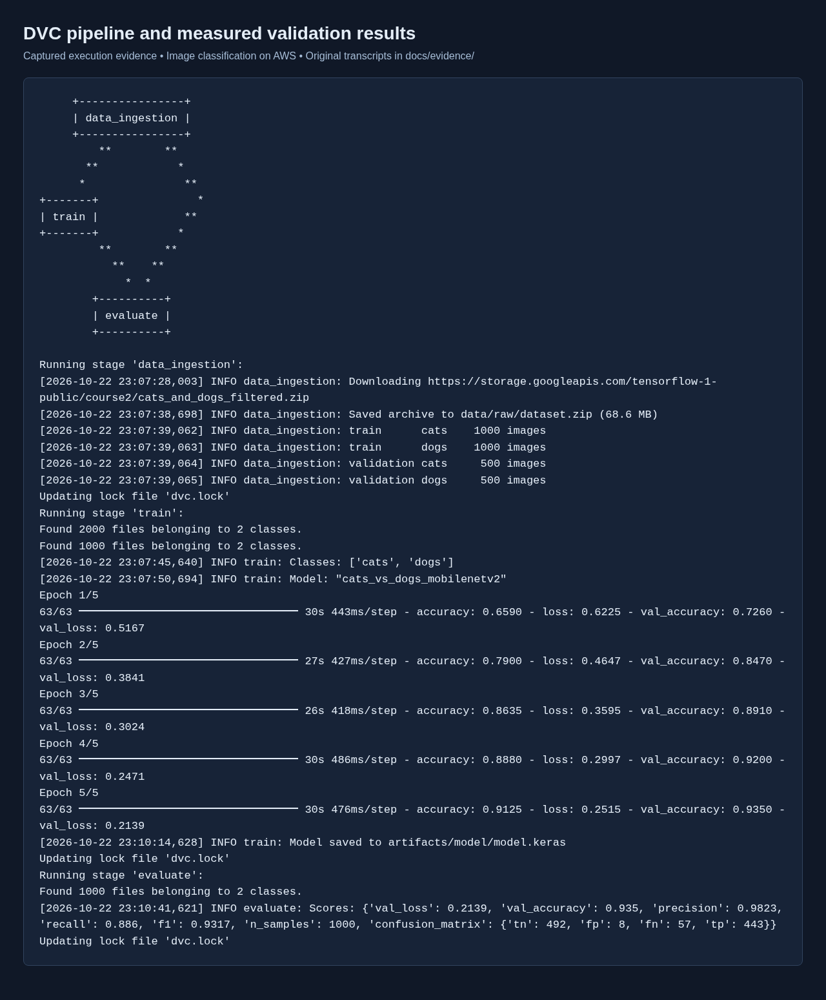
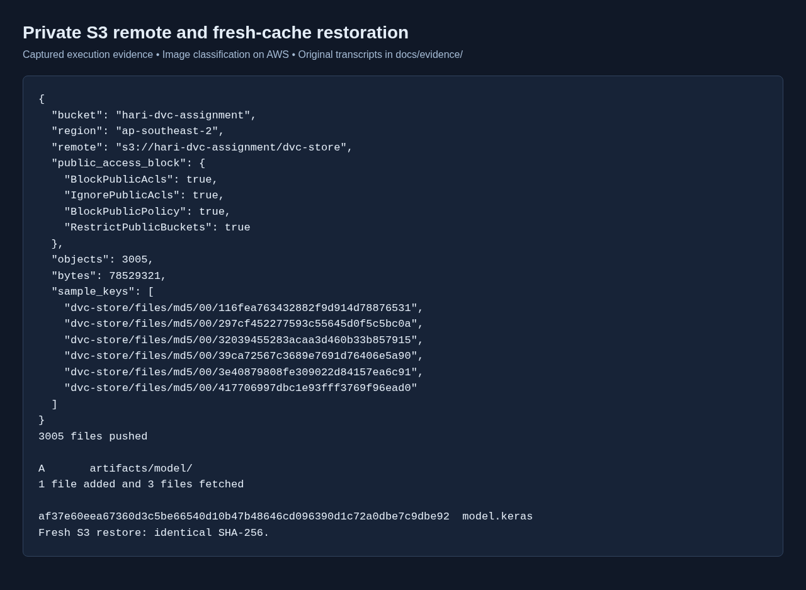
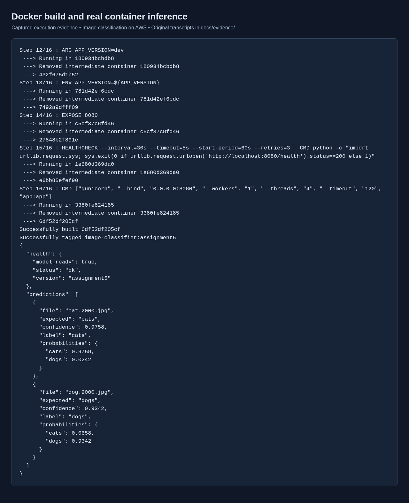
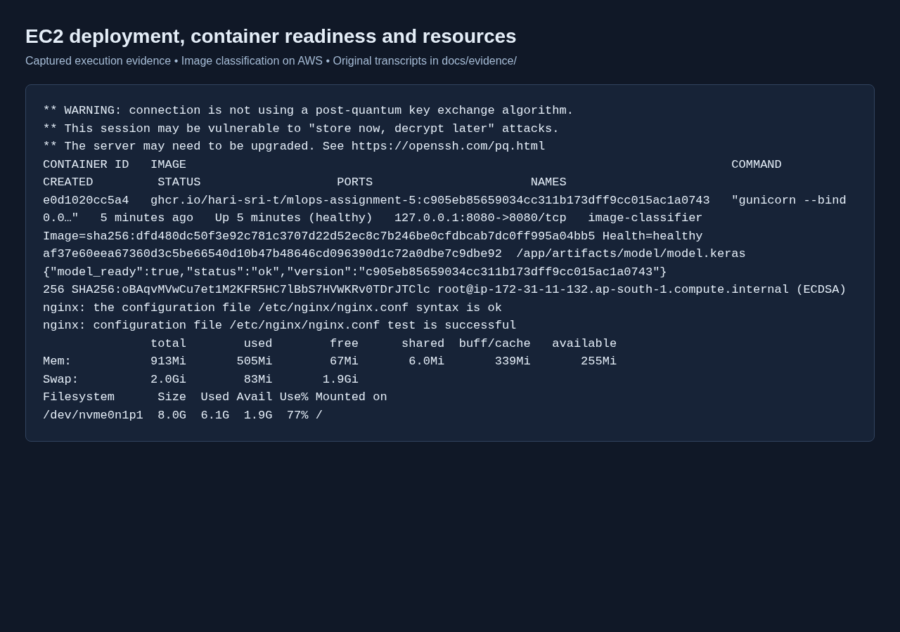
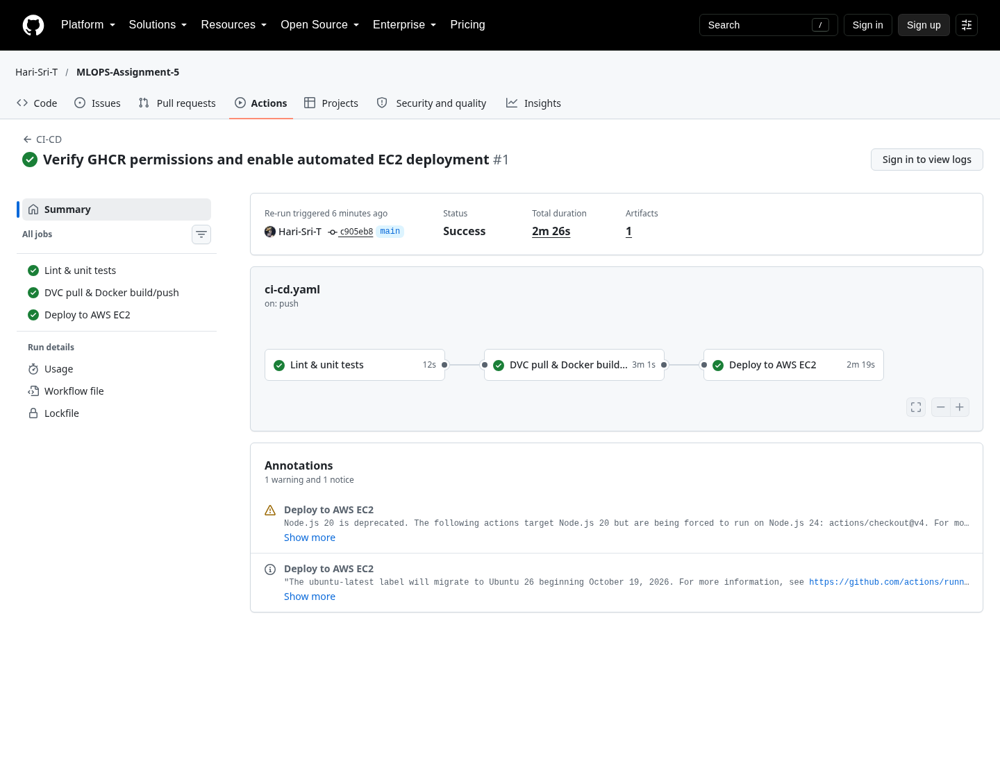
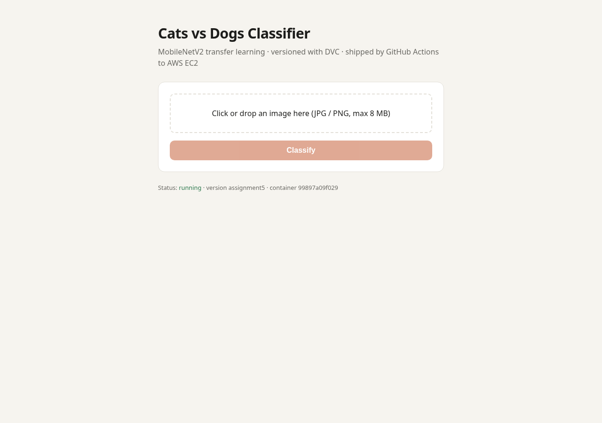
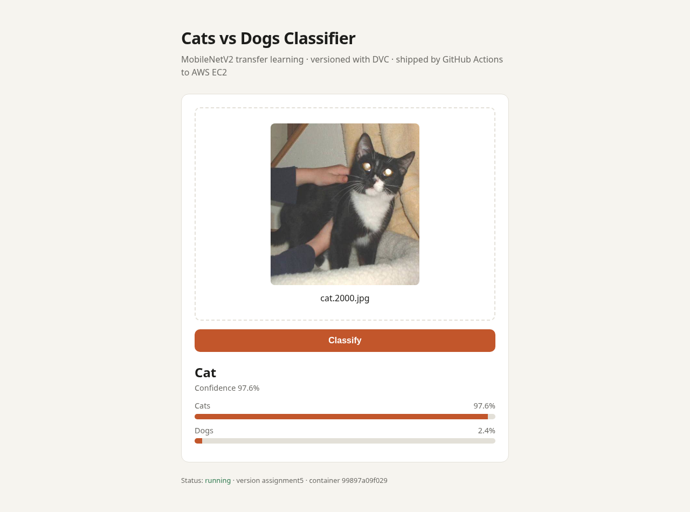
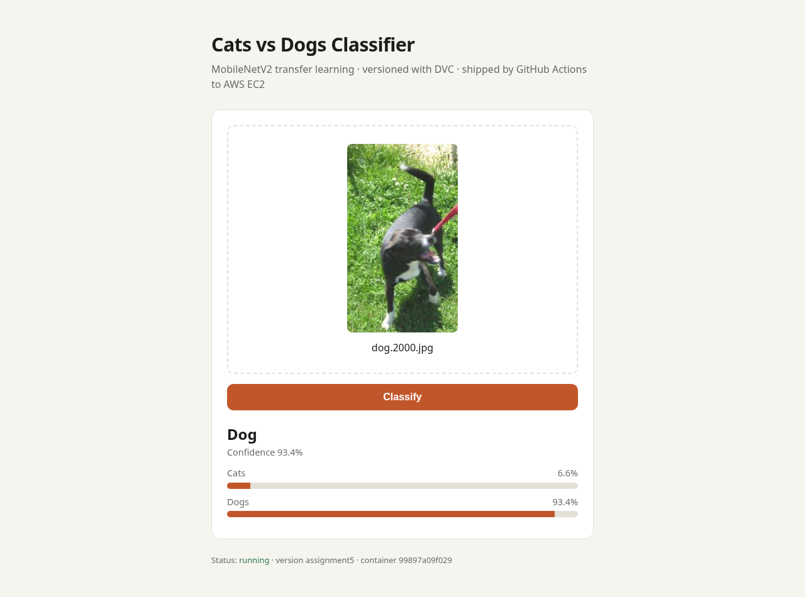
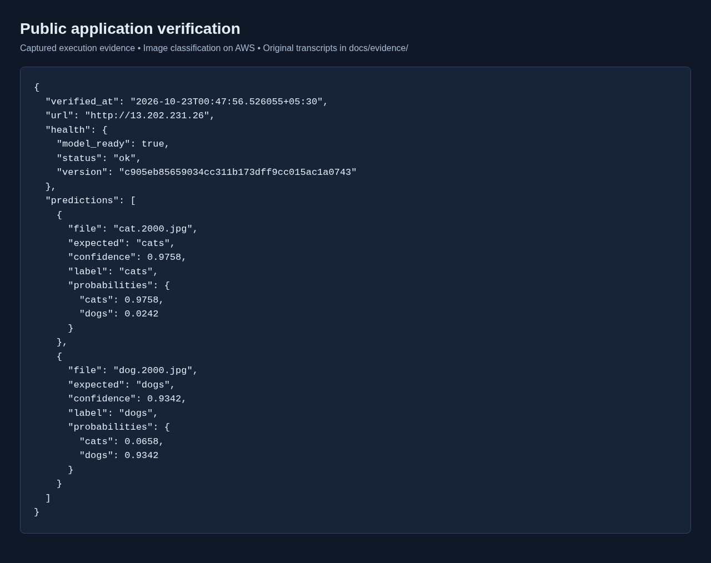

# Deploying an Image Classification Application on AWS Using Docker, DVC, and CI/CD

Project: MLOPS Assignment 5

Student name: Tanniru Hari Sri Shanmukha Sai

PRN: 23070126135

Implementation: 22–23 October 2026 (Asia/Kolkata)

## 1. Objective and implementation status

The project builds a cats-versus-dogs classifier and versions its data and trained model with DVC. A private S3 bucket holds DVC cache objects. Flask provides an image-upload interface and JSON prediction endpoint. Docker packages the application for EC2, while GitHub Actions defines testing, image publication, and SSH deployment.

Completed and verified: five-epoch training, evaluation, DVC lockfile generation, upload to private S3, restoration into an empty cache, Docker build, real container inference, EC2 Docker installation, Nginx configuration, public readiness and prediction checks. The EC2 instance was already running and supplied by the account owner; this session reused it rather than creating an additional billed instance.

CI/CD execution status: verified successful. GitHub Actions run 39836777627 completed all three jobs, including the public readiness and exact-version check. The SSH host-key mismatch on the first attempt was corrected using the verified ECDSA host fingerprint; deployment succeeded on attempt 2.

Public application: http://13.202.231.26/  
Public readiness: http://13.202.231.26/health

## 2. Architecture and project files

```text
Local: DVC ingestion → training → evaluation → dvc.lock + metrics
                         ↓ dvc push
            S3: hari-dvc-assignment/dvc-store (private)
                         ↓ dvc pull train
GitHub Actions: lint/tests → Docker build → GHCR → SSH to EC2
EC2: Nginx port 80 → Docker localhost:8080 → Gunicorn → Flask → model
```

| File or directory | Responsibility |
| --- | --- |
| dvc.yaml | Three pipeline stages, dependencies, parameters, outputs, metrics and plots |
| params.yaml | Dataset URL, paths, training settings and model paths |
| dvc.lock | Actual stage dependency and artifact checksums |
| .dvc/config | S3 remote URL and its region; contains no credentials |
| .github/workflows/ci-cd.yaml | Pull-request testing and main-branch build/deployment |
| Dockerfile | Python 3.11 CPU inference image, unprivileged user and health check |
| src/ | Download, train, evaluate, inference and shared utilities |
| app.py; templates/index.html | Web UI, prediction validation and readiness |
| scripts/ec2_setup.sh | Docker installation and 2 GB swap |
| scripts/deploy.sh | Pull, replace, check readiness and roll back on failure |
| scripts/nginx.conf | Public-IP host routing to the local container |
| tests/ | Application and deployment rollback tests |
| docs/evidence/; docs/screenshots/ | Original execution transcripts and actual browser captures |

## 3. Environment and prerequisites

The implementation uses Python 3.11.16, TensorFlow 2.20.0, DVC 3.59.1, Flask 3.1.0, Pillow 11.1.0 and Gunicorn 23.0.0. Direct dependencies are pinned in the two requirements files. A compatibility pin of pathspec 0.12.1 is required by the selected DVC version.

EC2 runs Amazon Linux 2023 on x86_64, has approximately 913 MiB of RAM and an 8 GiB root volume, and was reached as ec2-user using the owner-provided btech key pair. The instance is i-06c275d603a1b3688, with public IP 13.202.231.26, in ap-south-1 (Mumbai). The existing S3 bucket is in ap-southeast-2 (Sydney). Credentials remain in the owner's AWS profile; private keys and local credentials are excluded from Git, Docker context, and the submission archive.

Create a fresh working checkout and install development dependencies:

```bash
git clone https://github.com/Hari-Sri-T/MLOPS-Assignment-5.git
cd MLOPS-Assignment-5
python3.11 -m venv .venv
source .venv/bin/activate
pip install -r requirements-dev.txt
```

In the provided editing environment, .git was an empty read-only directory, so pipeline execution and Git publishing use a writable isolated checkout at /tmp/image-classifier-publish. Source changes, lockfile, metrics and the trained model are also copied back into the project directory. This is an environment workaround, not an application runtime requirement.

## 4. DVC pipeline creation and execution

The data_ingestion stage downloads the filtered cats-and-dogs archive and extracts it into data/raw/cats_and_dogs_filtered. There are 1,000 training images per class and 500 validation images per class. The train stage depends on the raw data and training utilities, and saves the Keras model plus class metadata into artifacts/model. The evaluate stage loads that exact model, scores all validation images, and writes scalar metrics and a confusion-matrix JSON.

DVC tracks source and helper dependencies as well as the relevant parameters. Training and evaluation depend explicitly on data.dataset_dir, and evaluation tracks model path parameters. This makes parameter or helper changes invalidate the correct stages. Model and raw data outputs are cached; small metrics and plot records remain in Git.

```bash
dvc repro
dvc dag
dvc metrics show
dvc plots show
dvc push
```

The lockfile was generated by the actual run, not hand-written. Subsequent runs reuse unchanged stages; changing a declared parameter makes DVC reproduce the affected work.



## 5. Model training and measured evaluation

MobileNetV2 uses ImageNet weights with its backbone frozen. The head consists of global average pooling, dropout 0.2, and one sigmoid output. Horizontal flipping, rotation, and zoom augment training images. A rescaling layer maps raw pixel values to [-1, 1], so inference supplies raw RGB pixels rather than normalizing twice.

| Setting | Value |
| --- | --- |
| Image size | 160 × 160 RGB |
| Batch size | 32 |
| Epochs | 5 |
| Optimizer | Adam |
| Learning rate | 0.0001 |
| Loss | Binary cross entropy |
| Seed | 42 |
| Trainable parameters | 1,281 |
| Frozen parameters | 2,257,984 |
| Training images | 2,000 |
| Validation images | 1,000 |

Measured results from metrics/scores.json:

| Metric | Observed value |
| --- | --- |
| Validation accuracy | 93.50% |
| Validation loss | 0.2139 |
| Dog-class precision | 0.9823 |
| Dog-class recall | 0.8860 |
| Dog-class F1 | 0.9317 |
| True negatives / false positives | 492 / 8 |
| False negatives / true positives | 57 / 443 |

The positive class is dogs. Evaluation reuses the validation split observed during training; it is not an independent test-set measurement. Scores establish the behavior of this trained artifact, not a guarantee for arbitrary uploaded images.

## 6. AWS S3 as DVC remote storage

The pre-existing bucket hari-dvc-assignment was discovered through read-only S3 APIs and its location verified as ap-southeast-2. All four S3 Block Public Access settings were confirmed enabled. The project's remote uses a separate dvc-store prefix.

```bash
dvc remote modify s3remote url s3://hari-dvc-assignment/dvc-store
dvc remote modify s3remote region ap-southeast-2
dvc push -j 8
```

A successful push reported 3,005 files. DVC stores content-addressed objects and directory manifests under dvc-store/files/md5/. A fresh independent checkout with an empty cache restored the model using dvc pull train. A SHA-256 comparison confirmed the restored model is identical to the trained artifact; the same checksum was obtained from the running EC2 container.

Use a bucket-level s3:ListBucket permission and object-level s3:GetObject / s3:PutObject permissions for local training. The CI reader only requires list/get. Configure credentials with AWS profiles or environment variables, then store CI keys as encrypted GitHub repository secrets. No S3 object needs public access.



## 7. Containerization and local verification

The Dockerfile starts from python:3.11-slim, installs the CPU TensorFlow runtime and web dependencies, then copies the application and the already-restored model. It exposes 8080, runs as appuser, and starts one Gunicorn worker with four request threads. TensorFlow intra-op/inter-op threads are limited to 2/1 to reduce resource usage. The Docker context excludes AWS configuration, private keys, Git metadata, data and report files.

```bash
dvc pull train
docker build --build-arg APP_VERSION=assignment5 -t image-classifier:assignment5 .
docker run -d --name image-classifier-check -p 127.0.0.1:18080:8080 image-classifier:assignment5
curl --fail http://127.0.0.1:18080/health
```

The readiness endpoint loads the actual model and class metadata before returning 200; it returns 503 when files are absent or loading fails. The Docker health check calls this endpoint. Local HTTP inference correctly classified cat.2000.jpg and dog.2000.jpg. Inference calls the model directly for one image, avoiding the per-call data pipeline created by model.predict.

The API checks presence of the upload, allowed filename extension, an 8 MB request limit, successful image decoding and model readiness. Client errors do not expose internal exceptions, and browser error text is inserted as text. The file control remains keyboard accessible.



## 8. EC2 setup and deployment

1. The owner supplied the existing running instance and btech.pem. SSH initially rejected the key because its mode was 0644; it was restricted to owner-read (0400), then the connection succeeded.
2. Inspect the operating system, architecture, memory, disk space and existing listeners before installing or starting services.
3. Run scripts/ec2_setup.sh to install Docker, enable its service, add ec2-user to the docker group and create 2 GiB of swap. Reconnect to apply group membership.
4. Build the image locally because the server has limited memory. Stream the compressed Docker image into docker load on EC2 so a second image archive is not kept on its small disk.
5. Nginx already serves another domain on ports 80/443. Add the supplied IP-specific host instead of stopping the existing web server. It proxies requests to 127.0.0.1:8080. nginx -t must pass before reloading.
6. Run the container with --restart unless-stopped and a localhost-only port binding. Confirm its Docker health state and public HTTP readiness.

```bash
chmod 400 btech.pem
ssh -i btech.pem ec2-user@13.202.231.26
bash scripts/ec2_setup.sh
# Reconnect, then install the Nginx host from the copied project.
sudo install -m 644 scripts/nginx.conf /etc/nginx/conf.d/image-classifier.conf
sudo nginx -t
sudo systemctl reload nginx
docker run -d --name image-classifier --restart unless-stopped -p 127.0.0.1:8080:8080 image-classifier:assignment5
```

The security group must permit public HTTP 80 and SSH from the authorized admin/deployment network. No public 8080 rule is required. For a new EC2 deployment, launch an x86_64 instance with its key pair and suitable storage, then perform the same setup. The AWS profile used here has S3 access but lacks EC2 describe/create privileges, so provisioning a second instance was not attempted.

The captured EC2 state shows a healthy container, working Nginx configuration, approximately 1.9 GiB free disk, and about 83 MiB swap use at the time of capture. Disk use must be watched as additional image versions accumulate; this project does not prune unrelated images automatically.



## 9. GitHub Actions CI/CD workflow

Place ci-cd.yaml under .github/workflows so GitHub detects it. A root-level YAML file alone is not a runnable Actions workflow.

- Pull requests to main run lint, application tests, rollback tests and Bash syntax checks without AWS credentials or a trained model.
- Pushes to main, and manual dispatch on main, run the build job after tests pass.
- The build job installs the pinned DVC version and compatible pathspec, authenticates to AWS, checks that dvc.lock exists and restores the train output from S3.
- Buildx publishes latest and full-commit tags to ghcr.io/hari-sri-t/mlops-assignment-5 using the built-in GITHUB_TOKEN with packages:write permission.
- An ephemeral container must pass model readiness and a synthetic-image prediction check before the deploy job can run. That smoke check confirms inference works; it does not measure accuracy.
- The SSH action verifies the EC2 host fingerprint. Its temporary GHCR authentication also works when the package is private and is removed after the pull.
- scripts/deploy.sh pulls the immutable commit tag, stops and renames the previous container, starts the replacement and waits for Docker readiness. Failure restores the previous container; success removes that backup.
- The final public check verifies model_ready and the exact commit in the version response. Workflow concurrency prevents overlapping deployments to the same branch.

| GitHub secret | Purpose |
| --- | --- |
| AWS_ACCESS_KEY_ID | S3 read identity |
| AWS_SECRET_ACCESS_KEY | Matching AWS secret |
| EC2_HOST | 13.202.231.26 |
| EC2_USER | ec2-user |
| EC2_SSH_KEY | Private key stored only as an encrypted Actions secret |
| EC2_SSH_FINGERPRINT | Verified ECDSA host fingerprint |

AWS_REGION defaults to ap-southeast-2 for the S3 bucket. GitHub registry authentication is separate from the EC2 SSH key. SSH access allows pushing Git commits, but configuring encrypted repository secrets requires GitHub API authorization or the owner's Settings interface.

Verified workflow run: https://github.com/Hari-Sri-T/MLOPS-Assignment-5/actions/runs/39836777627  
Deployed code commit: c905eb85659034cc311b173dff9cc015ac1a0743  
Completed workflow attempt: 2

| Job | Result | Duration |
| --- | --- | --- |
| Lint & unit tests | success | 12 seconds |
| DVC pull & Docker build/push | success | 181 seconds |
| Deploy to AWS EC2 | success | 139 seconds |



The published image is ghcr.io/hari-sri-t/mlops-assignment-5:c905eb85659034cc311b173dff9cc015ac1a0743. The public endpoint returns this same full commit. The bootstrap image was removed only after the automated rollout passed, reclaiming approximately 1.5 GiB of disk space.


## 10. Public application execution and checks

The browser opened http://13.202.231.26/, uploaded actual validation images and displayed real API responses. The public health endpoint returned status ok, model_ready true and version c905eb85659034cc311b173dff9cc015ac1a0743. The manual bootstrap used version assignment5; the final evidence and screenshots show the CI-deployed version. Verification was recorded at 2026-10-23T00:47:56.526055+05:30 in docs/evidence/public-verification.json.

| Sample | Predicted class | Confidence |
| --- | --- | --- |
| cat.2000.jpg | cats | 97.58% |
| dog.2000.jpg | dogs | 93.42% |

These two examples are execution checks; the separate 1,000-image evaluation supplies the aggregate validation accuracy.









The test suite contains 17 passing cases covering successful requests, missing uploads, invalid extensions, unavailable/broken models, corrupt images, oversized requests, preprocessing and probability mapping, plus deployment success and rollback after startup failure or an unhealthy replacement. Flake8 and Bash syntax checks also passed. Tests use stubs for fast CI; real-model behavior is checked separately in the container and public deployment.

## 11. Challenges and solutions

| Challenge | Applied solution |
| --- | --- |
| Host Python was 3.14, while TensorFlow runtime targets 3.11 | Create an isolated Python 3.11 environment matching Docker and CI. |
| DVC failed importing pathspec._DIR_MARK | Pin pathspec 0.12.1 in development and the CI DVC installation. |
| Old TensorFlow dataset endpoint returned 403 locally and on EC2 | Verify and use the accessible tensorflow-1-public/course2 copy of the same archive. |
| S3 bucket and EC2 use different regions | Configure the DVC remote and AWS Actions region for the bucket's Sydney location. |
| SSH ignored the world-readable private key | Restrict the owner-provided key to mode 0400. |
| Small EC2 memory/disk and existing services | Train/build locally, add swap, stream the image and use one inference worker. |
| Port 80 was already occupied by Nginx | Bind Docker to localhost:8080 and add a host for the public IP. |
| Long EC2 DNS name exceeded Nginx's server-name hash bucket | Use the short public IP as server_name; nginx -t then passed. |
| Health endpoint previously reported success with no model | Require successful loading of model and class metadata; test failure cases. |
| GitHub rejected the existing SSH key | Owner added its public key to GitHub; SSH authentication then succeeded. |
| GitHub SSH client selected a different host-key algorithm | Verify ECDSA and ED25519 fingerprints through the trusted connection, store the ECDSA fingerprint selected by the deployment client, and rerun deployment. |
| GitHub device authorization expired | Request a fresh browser authorization before configuring repository secrets. |

## 12. Submission contents and limitations

The submission includes application source, dvc.yaml, the working ci-cd.yaml under .github/workflows, Dockerfile, the generated lockfile and measured metrics, a PDF and editable Word report, screenshots and original evidence, plus repository and live application links. The source archive also includes the trained model for convenient local execution; the public Git repository versions that binary through DVC.

Screenshots of execution transcripts were taken with a real browser from the captured command output and are labeled as execution evidence. Application screenshots are actual public-URL browser captures. They are not reconstructed AWS console screens. The GitHub Actions screenshot is a capture of the actual public workflow page. Original command logs and JSON responses are retained beside the screenshots.

This is an educational single-instance HTTP deployment. Updates briefly interrupt service, the public IP can change after stopping the instance, and EC2/storage charges continue until the owner stops or removes resources. HTTPS, high availability and an independent test-set evaluation are outside this assignment implementation. The existing domain-based Nginx application remains in place. The complete CI/CD workflow and its public deployment were verified successfully.

## 13. References

- DVC pipeline reproduction: https://dvc.org/doc/command-reference/repro
- DVC pull and named-stage restoration: https://dvc.org/doc/command-reference/pull
- TensorFlow transfer learning: https://www.tensorflow.org/tutorials/images/transfer_learning
- Dataset used: https://storage.googleapis.com/tensorflow-1-public/course2/cats_and_dogs_filtered.zip
- S3 Block Public Access: https://docs.aws.amazon.com/AmazonS3/latest/userguide/access-control-block-public-access.html
- Docker container execution: https://docs.docker.com/engine/containers/run/
- SSH action inputs and host fingerprint: https://github.com/appleboy/ssh-action
- GitHub SSH key setup: https://docs.github.com/en/authentication/connecting-to-github-with-ssh/adding-a-new-ssh-key-to-your-github-account

## Google Drive submission

Complete project submission ZIP:

https://drive.google.com/file/d/1N9BKZ7av0fDJDdVRAaGO1bJtU_E5INIl/view?usp=drive_link

## GitHub repository

https://github.com/Hari-Sri-T/MLOPS-Assignment-5
